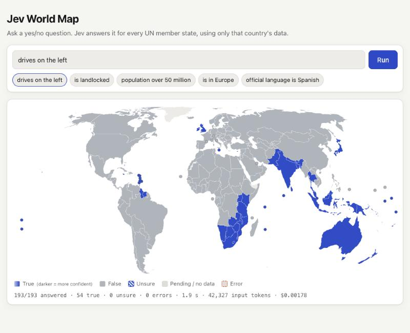
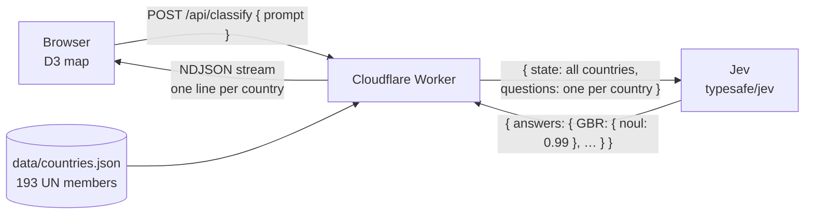

# Jev World Map

Ask a yes/no question about every country in the world, and watch [Jev](https://docs.typesafe.ai) answer it on a map.

Type a prompt like **"drives on the left"**, **"is landlocked"** or **"population over 50 million"**. A Cloudflare Worker asks Jev (TypeSafe's System One model, which returns calibrated probabilities) whether it's true for each of the 193 UN member states, using only that country's data. The map colours each country by the answer and shades it by confidence.



This is the companion code for the blog post **"How to integrate Jev: building a prompt-driven world map"** (Part 1).

## Results

All 193 countries in a single Jev request, compared with the country data snapshot:

| Prompt | Correct | Unsure | Time | Input tokens | Cost |
|---|---|---|---|---|---|
| drives on the left | 193/193 | 0 | 0.87 s | 42,327 | $0.0018 |
| is landlocked | 193/193 | 0 | 0.77 s | 42,134 | $0.0018 |
| population over 50 million | 193/193 | 0 | 0.80 s | 42,520 | $0.0018 |

Measured with `jev-1.13.0` via Cloudflare Workers AI.

## How it works



1. **Country data.** `data/countries.json` is a committed snapshot of the 193 UN member states, built from REST Countries v5. Each record has name, region, population, area, landlocked, driving side, languages, currencies and borders.
2. **One state, many questions.** Jev evaluates one `state` against any number of named questions in a single request. The Worker puts every country's record in the state, keyed by ISO3, and asks one yes/no (`noul`) question per country:

   ```js
   {
     state: { countries: { GBR: { name: 'United Kingdom', drivingSide: 'left', … }, … } },
     questions: {
       GBR: {
         type: 'noul',
         instructions: 'Based on the data in `countries.GBR`, is the following true of United Kingdom: "drives on the left"',
         criteria: { true: 'The statement is true for United Kingdom', false: 'The statement is false for United Kingdom' },
       },
       // …one per country
     },
   }
   ```

3. **Probabilities, not just yes/no.** Each answer is `{ type: 'noul', noul: 0.99 }`, the probability that the statement is true. The map treats ≥ 0.65 as true (darker = more confident), ≤ 0.35 as false, and anything between as **unsure** (hatched).
4. **Streaming.** The Worker streams results to the browser as NDJSON, one JSON object per line. With the default single request they arrive together. Set `JEV_BATCH_SIZE` to split countries across several requests, and the map fills in batch by batch.

## Quick start (no credentials)

Mock mode returns fake but repeatable answers, so you can run the whole app without a Cloudflare account.

```bash
npm install
```
```bash
cp .dev.vars.example .dev.vars
```
```bash
npm run dev
```

Open http://localhost:8787. `.dev.vars.example` ships with `MOCK_JEV=true`. Mock answers are random, so the map won't match reality.

## Using real Jev

1. **Credentials.** In `.dev.vars`, set:
   - `CLOUDFLARE_ACCOUNT_ID`: Cloudflare dashboard → Workers & Pages, in the sidebar
   - `CLOUDFLARE_API_TOKEN`: My Profile → API Tokens → Create Token, using the **Workers AI** template
   - `MOCK_JEV=false`
2. **Billing.** Jev is a third-party model, so Cloudflare charges for it separately from the Workers AI free allowance. Without credit you get `HTTP 402 Insufficient balance`. Either:
   - **Top up credits:** AI → AI Gateway → Credits Available → Manage, or
   - **Bring your own key:** AI → AI Gateway → your *default* gateway → Provider Keys → Add API Key → TypeSafe, using alias `default`. See [BYOK docs](https://developers.cloudflare.com/ai-gateway/configuration/bring-your-own-keys/).
3. Restart `npm run dev`.

A run of all 193 countries costs about $0.002 ($0.042 per 1M input tokens; output is free).

## Configuration

Settings live in `wrangler.jsonc` under `vars`:

| Variable | Default | What it does |
|---|---|---|
| `MOCK_JEV` | `false` | `true` = fake answers, no network calls |
| `JEV_BATCH_SIZE` | `0` | Countries per Jev request. `0` = all in one request |
| `JEV_CONCURRENCY` | `10` | Maximum Jev requests in flight at once |
| `JEV_TIMEOUT_MS` | `60000` | Timeout per Jev request |
| `JEV_MAX_RETRIES` | `3` | Retries on timeouts, 429s and 5xx (exponential backoff, honours `Retry-After`) |

## Project structure

```
data/countries.json        UN member snapshot (committed)
scripts/build-countries.js Rebuilds the snapshot from REST Countries v5
worker/index.js            Routes: GET /api/countries, POST /api/classify
worker/jev.js              The Jev integration: builds the request, parses the answers
worker/mock.js             Mock Jev with the same interface
worker/run.js              Batching, concurrency, retries, NDJSON streaming, structured logs
public/                    Static site (no build step): HTML, CSS, ES modules
  js/map.js                D3 map, Natural Earth 110m shapes via world-atlas
  js/stream.js             Reads the NDJSON stream with fetch()
  js/answer.js             Probability → true / false / unsure
```

## Things worth knowing

- **The REST response is wrapped twice.** Workers AI returns `{ result: { state: "Completed", result: { model, answers, usage } } }`. The docs show only the inner object. `worker/jev.js` unwraps both layers.
- **Context budget.** Jev 1.13 allows 64k tokens for the state plus all questions. All 193 countries come to about 42k (about 220 per country), which fits. If you add fields to the records, use `JEV_BATCH_SIZE` to split.
- **Know Jev's limits.** TypeSafe documents where Jev 1.13 is weaker: arithmetic, dates, counting, and large states full of irrelevant detail. See [Jev 1.13 jaggedness](https://docs.typesafe.ai/model-jaggedness/jev-1.13). Prompts that need maths may do worse than the table above suggests.
- **Small countries.** 28 UN members (Monaco, Singapore, Tuvalu, …) are too small for the 110m map shapes, so they're drawn as dots at their coordinates.
- **Structured logs.** Every Jev call and every run writes one JSON line to the console (`jev_call`, `classify`, `run_summary`), ready for benchmarking.

## Refreshing the country data

REST Countries v3.1 has been shut down, and v5 needs a free API key from [restcountries.com](https://restcountries.com/sign-up):

```bash
REST_COUNTRIES_API_KEY=your-key npm run build:countries
```

## Deploying

```bash
npx wrangler secret put CLOUDFLARE_ACCOUNT_ID
```
```bash
npx wrangler secret put CLOUDFLARE_API_TOKEN
```
```bash
npm run deploy
```

One Worker serves both the API and the static site. **Note:** a public deployment lets anyone spend your Jev balance. Add rate limiting or access control before you share the URL.

## Credits

- [Jev](https://docs.typesafe.ai) by TypeSafe, via [Cloudflare Workers AI](https://developers.cloudflare.com/ai/models/typesafe/jev/)
- Country data from [REST Countries](https://restcountries.com)
- Map shapes from [Natural Earth](https://www.naturalearthdata.com) via [world-atlas](https://github.com/topojson/world-atlas)
- [D3](https://d3js.org) and [topojson-client](https://github.com/topojson/topojson-client)

## License

[MIT](LICENSE)
